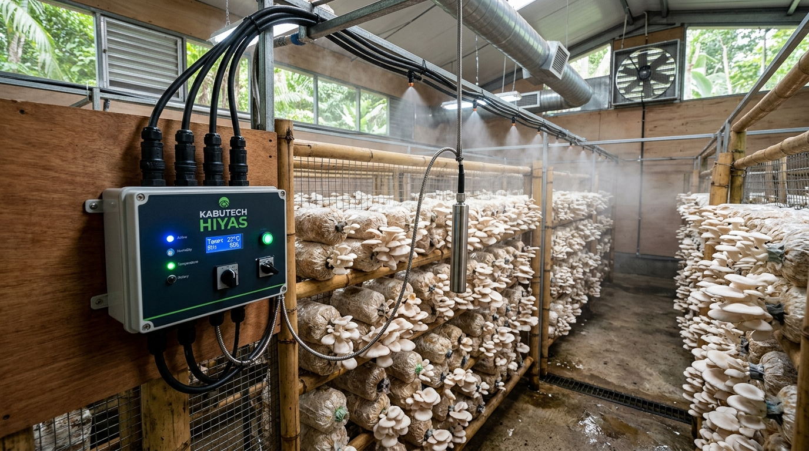
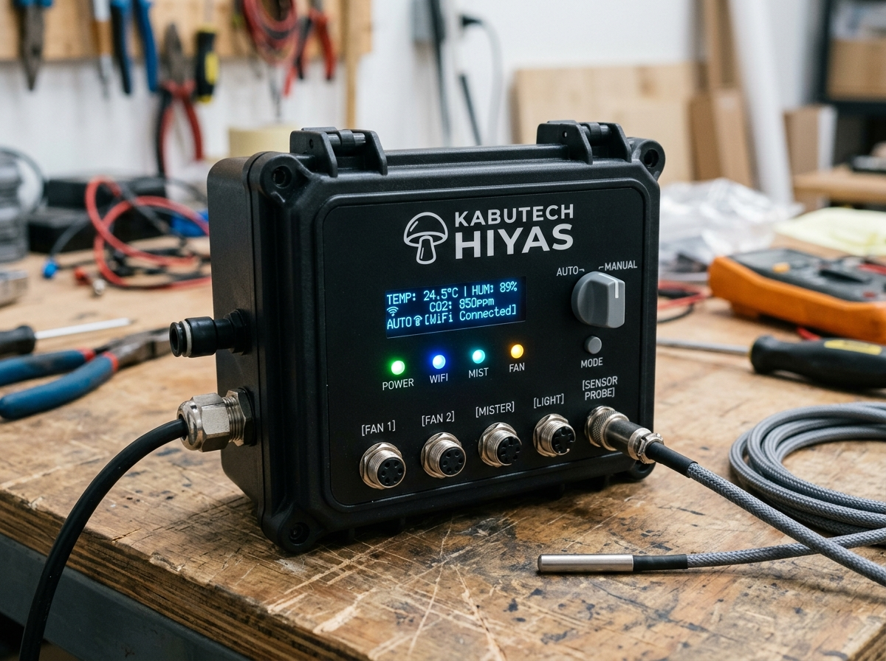
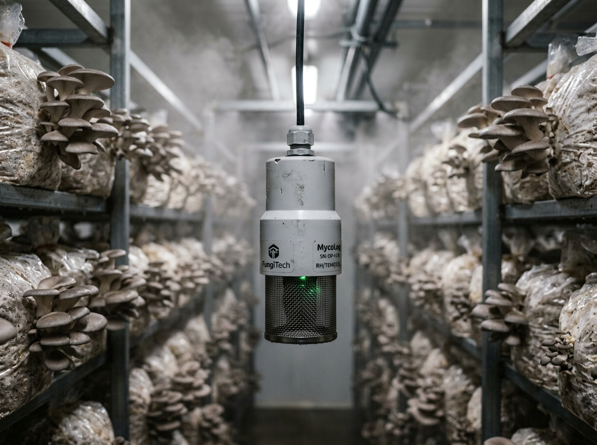

# Kabutech Hiyas — Plug-and-Play Grow House Implementation Plan

Transform the current sensor prototype into a universal plug-and-play automation system: **plug in power, connect the water line, and it runs.**

---

## 1. Executive Summary

| Aspect | Current Prototype | Production Target |
|---|---|---|
| **Form Factor** | Breadboard with loose jumper wires | Sealed IP65 industrial enclosure |
| **Actuator Control** | None (ESP32 only reads sensors) | 5-channel relay control (fans, misters, lights, valve) |
| **Sensors** | DHT11, LDR, MQ-135, resistive level | SHT31, BH1750, SCD41 (NDIR CO₂), capacitive level |
| **Sensor Protection**| Exposed directly to mist | Separated suspended probe, PTFE filter, louvered shield |
| **Connections** | Breadboard pins | Keyed GX16 aviation screw-lock connectors |
| **WiFi Setup** | Hardcoded in `.ino` source code | BLE / SoftAP mobile app setup wizard |
| **Autonomy** | Depends on cloud | Local PID control with offline resilience |

---

## 2. Remote Monitoring Architecture

The ESP32 and the mobile app communicate via Firebase Cloud Realtime Database. They do **not** need to be on the same WiFi network:

```
[ ESP32-S3 Controller ] ──(Grow House WiFi)──► [ Firebase RTDB ] ◄──(Mobile 4G/5G/WiFi)── [ User Mobile App ]
```

* **Global Access**: Monitor and control your grow house from anywhere in the world.
* **Low Latency**: State updates sync in real-time (~200–500ms).
* **Offline Fallback**: If internet drops, ESP32 continues autonomous climate control locally.

---

## 3. Hardware Architecture & Visual Design

### Grow House Installation Overview

*Figure 1: Wall-mounted IP65 controller box, overhead misting line, and canopy sensor probe suspended directly at mushroom bag height.*

### Controller Box Close-Up

*Figure 2: Sealed controller with OLED status display, status LEDs, rotary Auto/Manual mode switch, push-fit water fitting, and keyed GX16 aviation ports.*

### Connector Layout
* **[POWER IN]**: 220V AC mains with waterproof cable gland
* **[WATER IN / OUT]**: Quick-connect push-fit fitting (feeds misting line via internal 12V solenoid valve)
* **[FAN 1]**: GX16 4-Pin (Exhaust fan)
* **[FAN 2]**: GX16 4-Pin (Intake / Circulation fan)
* **[MISTER]**: GX16 4-Pin (High-pressure mist pump)
* **[LIGHT]**: GX16 4-Pin (Grow light LED strip)
* **[SENSOR PROBE]**: GX16 4-Pin (Shared I2C bus to external suspended probe)

---

## 4. Professional Hanging Sensor Probe (Multi-Plate Radiation Shield Design)

To eliminate messy DIY plumbing fabrication and achieve a commercial-grade agricultural finish, the suspended probe uses an off-the-shelf **Mini Multi-Plate Solar Radiation Shield** (meteorological louvered disc shelter). It hangs unobtrusively between grow racks, protects delicate sensors from overhead mist droplets, and requires zero pipe cutting or gluing.

### Hanging Probe Design Concept

*Figure 3: Compact suspended multi-plate radiation shield probe hanging among mushroom grow bags, featuring tiered louvered umbrella discs, top IP68 cable gland, and 360° natural air/CO₂ exchange.*

### The 5-Minute Build Steps
1. **The Shield Housing**: Procure a pre-assembled **Mini Multi-Plate Radiation Shield** (~₱250 on Shopee). It features 6–8 stacked downward-sloped white louvers with an internal central hollow chamber (~35–45mm diameter).
2. **Sensor Mounting**: 
   - Cut a slim vertical strip of **Perfboard (A7)** (~2.5cm × 6cm).
   - Solder the **SCD41** (CO₂), **SHT31-D** (Temp/Humidity), and downward-facing **BH1750** (Lux) modules along the strip, daisy-chaining their shared 3.3V I2C pins.
3. **Internal Suspension & Strain Relief**:
   - Feed the **4-Core Shielded Cable (E2)** through the top cable gland.
   - Solder the 4 cores to the perfboard pads.
   - Cinch a nylon zip tie around the cable jacket inside the chamber as a strain-relief anchor.
   - Tighten the top cable gland so the board hangs suspended in the dry center core of the shield.
4. **Hydrophobic Aperture Protection (Optional)**:
   - Affix a breathable **PTFE membrane disc** over the SCD41 intake to provide IP67 water droplet barrier protection.

### Why this design excels for the Thesis Defense:
- **Commercial Agricultural Polish**: It uses the exact same multi-disc meteorological shelter format employed by Davis Instruments, Meter Group, and high-end smart greenhouse nodes.
- **Natural Umbrella Shielding**: The tiered downward-slanted discs naturally shed falling water droplets from overhead mist nozzles.
- **Accurate Environmental Sampling**: Eliminates radiant heat bias on the SHT31 while providing open 360° natural air convection and molecular diffusion for fast CO₂ response.
- **Zero DIY Complexity**: Eliminates PVC pipe cutting, cement fumes, and fragile screen gluing.

> [!TIP]
> **Thesis Defense Script**
> *"We integrated our environmental sensing array into an industrial-standard multi-plate radiation shield. The tiered hydrophobic louver geometry prevents liquid droplet fouling on the Sensirion SCD41 photoacoustic aperture and eliminates radiant thermal bias on the SHT31, while maintaining uninhibited 360-degree gaseous diffusion and sub-second response times for autonomous climate regulation."*

---

## 5. Firmware Control & Safety Architecture

### Core Modules Needed
1. **Actuator Driver**: Reads Firebase `settings/setpoints/devices/*` and switches corresponding relay pins.
2. **Autonomous PID / Hysteresis Controller**: Maintains humidity (85–95%), temperature (22–26°C), and CO₂ (<1000ppm) locally on the ESP32.
3. **Smart Mister Pause**: When misters fire, temporarily freeze sensor sampling for 45 seconds to avoid mist-bias readings.
4. **Fail-Safe Watchdog**: If ESP32 crashes or sensor disconnects, default fans ON, misters OFF, and send Firebase alert.
5. **BLE / SoftAP Provisioning**: Allows growers to pair device to home WiFi without editing code.

---

## 6. Universal Grow House Adaptability & Biological Profiles

> [!NOTE]
> Grounded in peer-reviewed biological literature. For full citations and APA bibliography, see [refs/REFERENCES.md](file:///c:/Users/ADMIN/Documents/kabutech-hiyas-main/refs/REFERENCES.md) and [cropProfiles.ts](file:///c:/Users/ADMIN/Documents/kabutech-hiyas-main/KabutechNative/src/config/cropProfiles.ts).

### Preset Crop Profiles
| Parameter | Oyster Mushroom (*P. ostreatus*) | Shiitake | Lion's Mane | Literature Basis (Oyster) |
|---|---|---|---|---|
| **Temperature** | 18–25°C | 15–21°C | 18–24°C | Islam et al. (2022); Hu et al. (2023); Girmay et al. (2016) |
| **Relative Humidity** | 80–95% | 80–90% | 85–95% | Islam et al. (2022); Chong et al. (2023) |
| **CO₂ Concentration** | ≤ 1,000 ppm | < 1,000 ppm | < 800 ppm | Bellettini et al. (2019); Lin et al. (2022) |
| **Light Level** | 150–500 lux *(Max 1,000 lx)* | 500–1000 lux | 500–800 lux | Bellettini et al. (2019); Arjona et al. (2009) |
| **Air Exchange** | High | Medium | High | Mohammed et al. (2018) |

### First-Boot Auto-Calibration
When installed in a new grow house, the system runs an automatic 10-minute diagnostic:
1. Measures room baseline climate.
2. Pulses exhaust fan to measure air evacuation rate (calculates room volume).
3. Pulses mister to measure humidity rise rate.
4. Calibrates PID response curves specific to the grower's room size.

---

## 7. Firebase Realtime Database Schema

```json
{
  "kabutech": {
    "sensors": {
      "live": {
        "temperature": 24.5,
        "humidity": 89.2,
        "light": 720,
        "co2": 850,
        "waterLevel": 85,
        "waterFlow": 1.2,
        "esp32_status": "ONLINE"
      }
    },
    "settings": {
      "setpoints": {
        "temperature": 24.0,
        "humidity": 90.0,
        "light": 800,
        "co2": 900,
        "mode": "auto",
        "devices": {
          "fans": false,
          "misters": true,
          "lights": true,
          "waterValve": false
        }
      }
    },
    "device": {
      "firmwareVersion": "2.0.0",
      "wifiSignal": -58,
      "uptime": 86400,
      "lastSeen": 1726115000
    }
  }
}
```

---

## 8. Bill of Materials — Complete Shopping List (₱15,000 Budget)

> **Budget**: ₱15,000 · **Realistic Target**: ~₱12,000–₱13,500 with Shopee/Lazada vouchers · **Total Items**: 55+

### Budget Summary

| Category | Subtotal (₱) |
|---|---|
| A. Sensors & Probe Electronics | ₱3,150 – ₱4,100 |
| B. Sensor Probe Housing (PVC Bell) | ₱250 – ₱450 |
| C. Controller & Core Electronics | ₱1,380 – ₱2,150 |
| D. Power Supply & Distribution | ₱1,050 – ₱1,700 |
| E. Connectors & Wiring | ₱980 – ₱1,650 |
| F. Actuators (Fans, Mister, Valve, Light) | ₱2,130 – ₱4,050 |
| G. Enclosure & Mounting | ₱450 – ₱800 |
| H. Miscellaneous & Consumables | ₱380 – ₱650 |
| **GRAND TOTAL** | **₱9,770 – ₱15,550** |

---

### A. Sensors & Probe Electronics (Quality-Grade, I2C Digital)

| # | Component | Purpose | Specs | Qty | Price (₱) | Where to Buy |
|---|---|---|---|---|---|---|
| A1 | **SHT31-D Temp/Humidity Module** | Measures ambient air temperature and relative humidity to trigger misting and ventilation routines. | ±2% RH, ±0.3°C accuracy, I2C. Replaces DHT11 (±5% RH). | 1 | 120–180 | Shopee / Lazada / Makerlab PH |
| A2 | **BH1750 Digital Light Sensor (GY-302)** | Measures ambient illuminance (lux) to control grow light photoperiods for fruiting induction. | 1–65,535 lux, 16-bit resolution, I2C. Replaces unreliable LDR voltage divider. | 1 | 80–150 | Shopee / Lazada / Circuit Rocks |
| A3 | **SCD41 True NDIR CO₂ Sensor** | Accurately detects carbon dioxide levels (ppm) to trigger exhaust fans and prevent mushroom elongation. | Photoacoustic NDIR, 400–5,000 ppm, ±40 ppm, I2C. True CO₂ — not the fake "air index" of MQ-135. **Most expensive but most critical sensor.** | 1 | 1,800–2,500 | Shopee (search "SCD41") / AliExpress |
| A4 | **Capacitive Water Level Sensor (XKC-Y25-T12V)** | Detects water level through container walls to prevent mist pump dry-running and alert on low water. | Non-contact, no corrosion/electrolysis. Mounts outside reservoir wall. Digital output. | 1 | 250–400 | Shopee / Lazada / Makerlab PH |
| A5 | **YF-S201 Water Flow Sensor (Hall Effect)** | Verifies active water flow to misting nozzles and detects line clogs, leaks, or pump airlock. | 1–30 L/min, pulse output. Monitors water delivery to misting line. Food-grade nylon body. | 1 | 150–220 | Shopee / Lazada |
| A6 | **0.96" SSD1306 OLED Display (I2C)** | Displays real-time environmental metrics, system status, and WiFi connection directly on the controller box. | 128×64 px. Shows live readings, mode, WiFi signal on the controller box face. | 1 | 100–150 | Shopee / Lazada / Makerlab PH |
| A7 | **Perfboard / Prototype PCB (5×7cm, Double-Sided)** | Provides a rigid solder platform to mount and wire the I2C sensors securely inside the hanging probe. | Mounts SHT31 + BH1750 + SCD41 inside sensor probe. | 2 pcs | 50–100 | Shopee / local electronics store |
| | | | | **Subtotal:** | **₱3,150 – ₱4,100** | |

---

### B. Hanging Sensor Probe Housing (Mini Radiation Shield Design)

| # | Component | Purpose | Specs | Qty | Price (₱) | Where to Buy |
|---|---|---|---|---|---|---|
| B1 | **Mini Multi-Plate Solar Radiation Shield** | Suspended sensor shelter; tiered downward-sloped louvers shed falling mist while providing 360° airflow and CO₂ diffusion. | Multi-tier white ABS disc shelter, internal probe cavity (~35–45mm), top cable gland & mounting bracket. | 1 pc | 200–350 | Shopee / Lazada (search "Mini radiation shield sensor") |
| B2 | **PTFE Hydrophobic Membrane Disc (13–25mm)** | Breathable waterproof barrier disc placed over SCD41 intake; blocks water droplets (IP67) while allowing gaseous CO₂ transmission. | ePTFE membrane disc, hydrophobic IP67 rating, gas permeable. | 1 pc | 30–60 | Shopee (search "PTFE membrane disc sensor") |
| B3 | **Small Zip Ties / Nylon Cable Ties (100mm)** | Internal cable strain relief anchor inside the shield chamber to prevent pulling on solder joints. | 2.5mm × 100mm UV-resistant black nylon cable ties. | 1 pack | 25–40 | Hardware store / Shopee |
| B4 | **Printed Weatherproof Vinyl Label Sticker** | Identifies the probe unit with crisp commercial branding for thesis presentation. | "KABUTECH HIYAS — Environmental Probe SN-01". | 1 pc | 20–30 | Print shop / DIY inkjet on vinyl |
| | | | | **Subtotal:** | **₱275 – ₱480** | |

---

### C. Controller Board & Core Electronics

| # | Component | Purpose | Specs | Qty | Price (₱) | Where to Buy |
|---|---|---|---|---|---|---|
| C1 | **ESP32-S3 DevKit N16R8** (USB-C) | Central microcontroller that executes PID climate logic, samples sensors, and syncs with Firebase via WiFi/BLE. | 16MB Flash, 8MB PSRAM. WiFi + BLE 5.0. Dual-core 240 MHz. Verify "N16R8" in listing. | 1 | 350–500 | Shopee / Lazada / Makerlab PH / Circuit Rocks |
| C2 | **8-Channel Relay Module (5V, Optocoupled)** | Provides galvanic isolation to safely switch 12V actuator loads (fans, pump, light, valve) from low-voltage GPIOs. | Optically isolated. Controls: Exhaust Fan, Intake Fan, Mister Pump, Grow Light, Solenoid Valve. 3 spare channels for expansion. Each relay rated 10A/250VAC. | 1 | 180–280 | Shopee / Lazada / Makerlab PH |
| C3 | **Logic Level Shifter (3.3V ↔ 5V, Bi-Directional, 4-Ch)** | Safely interfaces ESP32 3.3V logic signals with 5V relay inputs and peripherals without risking GPIO damage. | ESP32 is 3.3V logic; relay needs 5V trigger. Protects GPIO pins. | 1 | 30–50 | Shopee / Lazada |
| C4 | **Mini Breadboard (170-Tie) or Screw Terminal Block Strip** | Organizes signal distribution and intermediate wiring junctions neatly inside the enclosure. | Internal wiring distribution inside enclosure. | 2 | 50–80 | Shopee / electronics store |
| C5 | **LM2596 DC-DC Buck Converter (Adjustable)** | Efficiently steps down primary 12V DC power to regulated 5V DC for the ESP32, relays, and sensors. | Steps 12V → 3.3V/5V for ESP32 and sensors. More efficient than linear regulators. | 1 | 40–70 | Shopee / Lazada |
| C6 | **5V Voltage Regulator Module (7805 or AMS1117-5.0)** | Provides a dedicated, low-noise secondary 5V rail to prevent relay-switching noise from resetting the ESP32. | Clean 5V rail for relay module logic and noise isolation. | 1 | 20–40 | Shopee / electronics store |
| C7 | **Rotary/Toggle Switch (3-Position: Auto/Off/Manual)** | Allows direct manual override or shutdown of automation locally without needing the mobile app. | Panel-mount. Switch between Auto PID mode, Off, and Manual override without app. | 1 | 30–50 | Shopee / hardware store |
| C8 | **5mm LEDs (Red, Green, Blue, Yellow) + 220Ω Resistors** | Gives clear visual panel feedback for Power (Green), WiFi (Blue), Alarm (Red), and Auto Mode (Yellow). | Status indicators: Power (Green), WiFi (Blue), Alarm (Red), Mode (Yellow). | 1 set (10+10) | 30–40 | Shopee / electronics store |
| C9 | **Push Button (Momentary, Panel-Mount, 12mm)** | Provides an externally accessible reset and WiFi re-pairing trigger without opening the enclosure. | Reset button accessible from outside the box. | 1 | 15–30 | Shopee / electronics store |
| C10 | **10kΩ Resistors (¼W, Assorted Pack)** | Serves as pull-up resistors for the I2C bus lines and stable reference pull-downs for digital inputs. | Pull-ups for I2C bus and general purpose. | 1 pack (20 pcs) | 20–30 | Shopee / electronics store |
| C11 | **1N4007 Diodes (Flyback Protection)** | Suppresses inductive reverse-voltage spikes from relay coils and solenoid valve to protect circuit components. | Across relay coils and solenoid. Prevents back-EMF spikes from destroying ESP32. **Critical.** | 1 pack (10 pcs) | 15–30 | Shopee / electronics store |
| C12 | **Blade Fuse Holder (Inline, 5A) + Fuses** | Protects the 12V internal DC power bus against overcurrent and short circuits to prevent fire hazards. | Protects 12V power rail. Fuse blows instead of burning wires on short circuit. | 2 | 50–100 | Shopee / automotive shop |
| | | | | **Subtotal:** | **₱1,380 – ₱2,150** | |

---

### D. Power Supply & Distribution

| # | Component | Purpose | Specs | Qty | Price (₱) | Where to Buy |
|---|---|---|---|---|---|---|
| D1 | **12V 10A (120W) Enclosed Switching Power Supply** | Converts 220V AC mains into regulated 12V DC power for all fans, pump, solenoid, lights, and step-down circuits. | Mean Well LRS-150-12 or equivalent. 220VAC → 12VDC. 120W heavy-duty headroom. Short-circuit & overload protected. | 1 | 450–850 | Shopee / Lazada / Alexan |
| D2 | **IEC 320 C14 Inlet Socket with Fuse Holder** | Standardized, fused chassis-mount receptacle for plugging in the main AC power cord safely. | Standard computer-style power inlet. Mounts on enclosure. Accepts standard 220V cord. Built-in fuse. | 1 | 60–100 | Shopee / Lazada / Alexan |
| D3 | **220V AC Power Cord (3-Prong, 1.5m)** | Connects household wall outlet power to the enclosure inlet socket with grounding safety. | Standard PH 3-pin plug → IEC C13 connector. | 1 | 80–150 | Hardware store / Shopee |
| D4 | **Terminal Block Strip (12-Position, 15A)** | Provides neat, screw-clamped distribution hubs for 12V DC positive, ground, and relay outputs. | Screw-type for clean 12V power distribution. No loose jumper wires. | 2 | 60–120 | Shopee / hardware store |
| D5 | **Wago 221 Lever-Nut Connectors (3-Way, 5-Pack)** | Enables quick, reusable, tool-free splicing of AC mains lines and DC power branch circuits. | Quick-connect, tool-free, reusable wire splicing. For internal 12V branching. | 2 packs | 100–160 | Shopee / Lazada |
| D6 | **Rocker Switch (KCD1, ON/OFF, 220V 6A, Illuminated)** | Master power on/off switch with an integrated indicator light showing when AC mains is energized. | Master power switch on enclosure face. Red LED indicator. | 1 | 25–40 | Shopee / hardware / electronics store |
| D7 | **Varistor / MOV (275V, 10D)** | Absorbs high-voltage surges and brownout spikes from the AC grid to safeguard internal power electronics. | Surge protector at AC inlet. Absorbs voltage spikes from PH grid brownouts. | 1 | 25–30 | Shopee / electronics store |
| | | | | **Subtotal:** | **₱1,050 – ₱1,700** | |

---

### E. Connectors & Wiring

| # | Component | Purpose | Specs | Qty | Price (₱) | Where to Buy |
|---|---|---|---|---|---|---|
| E1 | **GX16 4-Pin Aviation Connectors (Male + Female Set)** | Provides vibration-resistant, screw-locking quick-connect ports on the enclosure for external actuators and probe. | Keyed, screw-lock, vibration-resistant. 1 set per port: Exhaust Fan, Intake Fan, Mister, Light, Sensor Probe, Water Flow. | 6 sets | 300–600 | Shopee / Lazada (search "GX16 4 pin") |
| E2 | **4-Core Shielded Cable (22AWG, 3 meters)** | Transmits I2C data (SDA, SCL) and power (VCC, GND) to the hanging probe with foil shielding against electrical noise. | Controller box → hanging sensor probe (I2C: SDA, SCL, VCC, GND). Shielded to prevent noise. | 1 roll (3m) | 100–180 | Shopee / Lazada |
| E3 | **18 AWG Silicone Stranded Wire (Red + Black, 5m each)** | Handles high-current 12V DC power routing from PSU to relays and pump with high heat tolerance and flexibility. | Main 12V power wires. Silicone jacket = heat-resistant + flexible. | 2 colors × 5m | 80–120 | Shopee / Lazada |
| E4 | **22 AWG Hookup Wire (Assorted Colors, 5m rolls)** | Carries low-current control signals, relay trigger lines, and LED status wiring inside the enclosure. | Signal wires for sensors, relay triggers, LED indicators. | 1 assorted set (6 colors) | 60–100 | Shopee / electronics store |
| E5 | **Dupont Jumper Wires (M-F, M-M, F-F, 20cm, 40-Pin)** | Quick modular connections between the ESP32 headers, level shifters, and prototype sub-circuits. | Prototyping connections between ESP32 and relay/sensors. | 3 sets | 90–150 | Shopee / Lazada |
| E6 | **IP68 Waterproof Cable Glands (PG9/PG11, Nylon)** | Clamps and seals cable entries through the box walls to preserve the IP65 dust and moisture seal. | Seals cable entries on enclosure walls. Prevents moisture ingress. | 6 | 90–180 | Shopee / hardware store |
| E7 | **Heat Shrink Tubing Kit (Assorted Sizes)** | Insulates exposed solder joints and connector terminals to prevent accidental shorts and corrosion. | Insulates solder joints. Essential for safe, professional wiring. | 1 kit (120 pcs) | 60–100 | Shopee / Lazada |
| E8 | **JST-XH 2.54mm Connectors (2P, 3P, 4P Kit)** | Makes internal sub-modules (sensors, OLED, switches) modular and detachable for easy servicing. | Pluggable internal connectors. Allows swapping modules without desoldering. | 1 kit | 50–80 | Shopee / Lazada |
| E9 | **Female Header Pin Strips (2.54mm, 40-Pin)** | Creates a socketed mount for the ESP32-S3 DevKit so it can be unseated for flashing or replacement without desoldering. | Socket strips so ESP32 is removable from internal perfboard. | 2 strips | 30–40 | Shopee / electronics store |
| E10 | **Solder Wire (60/40, 0.8mm, 50g Roll)** | Creates permanent, highly conductive, vibration-proof joints on circuit boards and wire terminals. | Permanent soldered connections on perfboard and sensor wiring. | 1 roll | 50–80 | Shopee / hardware store |
| | | | | **Subtotal:** | **₱980 – ₱1,650** | |

---

### F. Actuators (The Things Being Controlled)

> All actuators are **12V DC** — safer than 220V AC for a thesis prototype, and all powered from the single 12V 5A PSU.

| # | Component | Purpose | Specs | Qty | Price (₱) | Where to Buy |
|---|---|---|---|---|---|---|
| F1 | **12V DC Exhaust Fan (120mm / 4")** | Exhausts stagnant, CO₂-heavy air from the grow room when CO₂ exceeds set thresholds. | Extracts stale CO₂-rich air. Ball-bearing motor for humid environment longevity. ~0.3A. | 1 | 180–400 | Shopee / Lazada (search "12V exhaust fan 120mm") |
| F2 | **12V DC Circulation / Intake Fan (80–120mm)** | Draws in fresh outdoor air and circulates air across mushroom bags to eliminate stagnant microclimates. | Fresh air intake + air circulation inside grow house. | 1 | 130–300 | Shopee / Lazada |
| F3 | **12V DC High-Pressure Misting Pump** (Diaphragm, 4–5 L/min) | Delivers pressurized water to the misting line to create ultra-fine fog that raises relative humidity. | Self-priming diaphragm pump. Fine mist through 0.3mm brass nozzles. Feeds misting line. ~3A peak. | 1 | 350–800 | Shopee / Lazada (search "12V diaphragm mist pump") |
| F4 | **Brass Misting Nozzles (0.3mm orifice)** | Atomizes water into fine micro-droplets (fog) that suspend in air without soaking or bruising mushroom caps. | Ultra-fine mist for humidity. Anti-drip type. | 5 pcs | 75–150 | Shopee / Lazada / hardware store |
| F5 | **Misting Line Kit (6mm PE Tubing + Tee Fittings)** | Overhead water delivery line connecting the pump output to misting nozzles suspended above grow bags. | 5m PE tubing + T-connectors + end plugs. Pump → nozzles overhead. | 1 kit | 150–350 | Shopee / Lazada (search "misting kit 6mm") |
| F6 | **12V DC Solenoid Valve (½" or ¾", Normally Closed)** | Electronically controls water line feed into the system; shuts off automatically if power drops to prevent flooding. | Controls water flow from supply to pump/reservoir. NC = water OFF if power lost (safe default). | 1 | 250–450 | Shopee / Lazada / Makerlab PH |
| F7 | **Quick-Connect Push-Fit Water Fitting (½" → 6mm)** | Adapts threaded solenoid output to flexible 6mm PE tubing with a leak-proof push-in connection. | Connects solenoid output to PE misting tubing. Tool-free, leak-proof. | 2 pcs | 60–120 | Hardware store / Shopee |
| F8 | **12V LED Grow Light Strip (Full Spectrum, 1m, IP65)** | Provides targeted light spectrum to stimulate mushroom pinhead formation and fruiting body development. | Red + Blue + White spectrum for mushroom fruiting stimulation. Waterproof. | 1 strip | 300–800 | Shopee / Lazada (search "grow light strip 12V") |
| F9 | **Water Reservoir / Container (5–10 Liters)** | Stores dedicated clean water for misting, protecting pump and nozzles from hard-water mineral buildup. | Stores water for misting system. Any food-grade plastic container with lid. | 1 | 80–200 | Hardware store / grocery (upcycle any clean container) |
| F10 | **Teflon Tape (PTFE, ½")** | Seals threaded pipe joints on the solenoid valve and push-fit adapters to prevent pressurized water leaks. | Seals all threaded water fittings. | 1 roll | 25–30 | Any hardware store |
| F11 | **Hose Clamps (Stainless Steel, 10–16mm)** | Clamps flexible tubing tightly over pump barbs to prevent high-pressure disconnections. | Secures PE tubing to barbed fittings. Prevents blowouts under pump pressure. | 4 pcs | 40–60 | Hardware store |
| F12 | **Check Valve (Non-Return, 6mm Inline)** | Maintains prime in the misting line and prevents water backflow into the pump when misting pauses. | Prevents water backflow when pump shuts off. Keeps misting line primed. | 1 | 40–90 | Shopee / aquarium store |
| | | | | **Subtotal:** | **₱2,130 – ₱4,050** | |

---

### G. Enclosure & Mounting

| # | Component | Purpose | Specs | Qty | Price (₱) | Where to Buy |
|---|---|---|---|---|---|---|
| G1 | **IP65 ABS Waterproof Enclosure Box (255×200×80mm)** | Encloses and seals the central controller, relays, and power supply against humid air, mist, and dust. | Sealed, dustproof, splashproof. Fits ESP32 + relay + PSU + terminal blocks. Wall-mountable. | 1 | 300–500 | Shopee / Lazada / hardware store |
| G2 | **DIN Rail (15cm) + DIN Rail Terminal Blocks** | Provides a rigid industrial-standard mounting track to snap power modules and terminal blocks into place cleanly. | Optional but professional — mounts relay & PSU in organized industrial layout. | 1 set | 60–120 | Shopee / Lazada |
| G3 | **Self-Adhesive PCB Standoffs / Nylon Spacers (M3)** | Mounts circuit boards securely above the enclosure floor to isolate solder pins and prevent short circuits. | Mounts ESP32 and perfboards off enclosure floor. Prevents short circuits. | 1 set (20 pcs) | 30–50 | Shopee / electronics store |
| G4 | **Wall-Mount Brackets + Screws (Stainless Steel)** | Securely anchors the controller enclosure to the grow room wall or rack frame without rusting in high humidity. | Mounts enclosure to grow house wall. Stainless = resists humidity corrosion. | 1 set | 30–60 | Hardware store |
| G5 | **Rubber Grommets (Assorted Sizes)** | Lines drilled enclosure holes to cushion wiring and protect cable insulation against sharp chassis edges. | Protects wiring at drilled holes. Prevents cable chafing. | 1 pack | 30–50 | Shopee / hardware store |
| | | | | **Subtotal:** | **₱450 – ₱800** | |

---

### H. Miscellaneous Tools & Consumables

| # | Component | Purpose | Specs | Qty | Price (₱) | Where to Buy |
|---|---|---|---|---|---|---|
| H1 | **USB-C Cable (1m, Data + Charge)** | Connects the ESP32-S3 to a computer for flashing firmware, viewing serial debugging logs, and testing. | Firmware flashing and Serial Monitor debugging. Must support data (not charge-only). | 1 | 50–100 | Shopee / phone accessories store |
| H2 | **Step Drill Bit (4–20mm, Titanium Coated)** | Cuts smooth, exact diameter holes in the ABS enclosure for aviation ports, glands, buttons, and switches. | Drills clean holes in ABS enclosure for GX16 (16mm), cable glands, switches, LEDs. | 1 | 100–200 | Shopee / hardware store |
| H3 | **Electrical Tape (Black, 3M or equiv.)** | Provides rapid electrical insulation and neat wire bundling during assembly and cable routing. | General insulation and wire bundling. | 2 rolls | 50–80 | Hardware store |
| H4 | **Double-Sided Foam Tape (3M VHB or similar)** | Adheres the OLED display, indicator LEDs, and lightweight modules flush against the enclosure panel. | Mounts OLED display and LED indicators to enclosure face. | 1 roll | 40–80 | Shopee / hardware store |
| H5 | **Silicone Sealant (Clear, Weatherproof)** | Fills gaps around panel-mounted glands, displays, and switches to maintain an IP65 waterproof rating. | Seals around cable glands and drilled holes to maintain IP65 rating. | 1 tube | 80–120 | Hardware store |
| H6 | **Label Maker Tape / Vinyl Sticker Paper** | Produces clear waterproof port labels ([POWER IN], [FAN 1], [MISTER], etc.) for intuitive plug-and-play operation. | Labels for ports: [POWER IN], [FAN 1], [FAN 2], [MISTER], [LIGHT], [SENSOR PROBE]. | 1 set | 30–50 | Shopee / print shop |
| H7 | **Soldering Iron (40W) + Stand + Sponge** | Used to make solid, corrosion-resistant solder connections on perfboards, aviation jacks, and wire leads. | Skip if you already own one. Essential for permanent connections. | 1 | 0–350 | Shopee / hardware store |
| | | | | **Subtotal:** | **₱380 – ₱650** | |

---

### Shopping Checklist by Source

**From Shopee / Lazada (Electronics):**
- [ ] SHT31-D module × 1 — *Measures temperature & humidity to trigger misting and ventilation*
- [ ] BH1750 (GY-302) module × 1 — *Measures light levels to regulate fruiting photoperiods*
- [ ] SCD41 NDIR CO₂ module × 1 — *True CO₂ sensing to trigger exhaust fan for fresh air exchange*
- [ ] Capacitive water level sensor (XKC-Y25) × 1 — *Non-contact reservoir monitoring to prevent pump dry-running*
- [ ] YF-S201 water flow sensor × 1 — *Detects mist line water delivery, leaks, or clogs*
- [ ] 0.96" OLED display (SSD1306, I2C) × 1 — *Local enclosure display for live readings, mode, and WiFi*
- [ ] ESP32-S3 DevKit N16R8 (USB-C) × 1 — *Main microcontroller executing PID loops and Firebase sync*
- [ ] 8-Channel relay module (optocoupled) × 1 — *Optically isolated 12V switching for all actuators*
- [ ] Logic level shifter (3.3V ↔ 5V) × 1 — *Translates 3.3V ESP32 signals safely to 5V relay inputs*
- [ ] LM2596 DC-DC buck converter × 1 — *Steps down 12V to 5V for microcontroller and sensors*
- [ ] 12V 5A enclosed switching PSU × 1 — *Main power supply converting 220VAC to 12VDC*
- [ ] IEC C14 power inlet with fuse × 1 — *Chassis-mount AC power socket with integrated safety fuse*
- [ ] GX16 4-pin connectors × 6 sets — *Screw-locking plug-and-play quick-disconnect ports*
- [ ] 4-core shielded cable (3m) × 1 — *Noise-shielded umbilical connection to hanging probe*
- [ ] IP65 ABS enclosure (255×200×80mm) × 1 — *Watertight, dustproof controller housing box*
- [ ] Cable glands PG9/PG11 × 6 — *Moisture-proof seals for enclosure wire entries*
- [ ] Heat shrink tubing kit × 1 — *Electrical insulation and strain relief for soldered joints*
- [ ] JST-XH connector kit × 1 — *Modular internal wire harnesses for easy servicing*
- [ ] Wago 221 lever-nut connectors × 2 packs — *Tool-free, reusable AC and DC power distribution*
- [ ] Step drill bit (4–20mm) × 1 — *Drilling clean, precise holes in enclosure without cracking*
- [ ] 12V exhaust fan (120mm) × 1 — *Purging high CO₂ and stale air from grow space*
- [ ] 12V circulation fan (80–120mm) × 1 — *Circulating fresh intake air across mushroom bags*
- [ ] 12V diaphragm misting pump × 1 — *Pressurizing water line to generate fine humidity fog*
- [ ] 12V solenoid valve (NC, ½"–¾") × 1 — *Automatic water shutoff to prevent reservoir flooding*
- [ ] 12V LED grow light strip (IP65, 1m) × 1 — *Stimulating mushroom pinhead initiation and growth*
- [ ] Brass misting nozzles 0.3mm × 5 — *Atomizing water into fine fog without soaking caps*
- [ ] Misting line kit (6mm PE tubing, 5m) × 1 — *Overhead distribution line feeding mist nozzles*
- [ ] Silicone wire 18AWG (red 5m + black 5m) — *High-current 12V DC power distribution*
- [ ] Hookup wire 22AWG assorted colors — *Color-coded internal signal and logic wiring*
- [ ] Dupont jumper wires (M-F, M-M, F-F) × 3 sets — *Internal prototype interconnects*

**From Hardware Store (Citi Hardware / Wilcon / Ace):**
- [ ] 2" → 1" PVC bell reducer × 1 — *Conical hanging probe body that sheds overhead mist*
- [ ] PVC solvent cement × 1 tube — *Bonding bottom filter mesh and sealing probe body*
- [ ] Fine stainless steel mesh / nylon screen × 1 sheet — *Bottom probe shield blocking mist while passing air*
- [ ] Teflon tape ½" × 1 roll — *Sealing threaded water fittings against high-pressure leaks*
- [ ] Hose clamps stainless 10–16mm × 4 — *Securing tubing over pump barbs under pressure*
- [ ] Quick-connect push-fit fittings ½" → 6mm × 2 — *Tool-free adaptation from valve to 6mm PE tubing*
- [ ] 220V power cord 3-prong 1.5m × 1 — *Grounded AC mains cord from wall outlet*
- [ ] Electrical tape × 2 rolls — *Wire bundling and auxiliary insulation*
- [ ] Silicone sealant clear × 1 tube — *Waterproofing drilled enclosure ports for IP65 rating*
- [ ] Rubber grommets assorted × 1 pack — *Protecting wire insulation against drilled hole edges*
- [ ] Wall-mount brackets + SS screws × 1 set — *Corrosion-resistant wall mounting for controller box*
- [ ] Water reservoir 5–10L × 1 — *Dedicated clean water storage for misting pump*

### Grand Total

```
┌───────────────────────────────────────┬──────────────────┐
│ Category                              │ Cost Range (₱)   │
├───────────────────────────────────────┼──────────────────┤
│ A. Sensors & Probe Electronics        │  3,150 –  4,100  │
│ B. Sensor Probe Housing (PVC Bell)    │    250 –    450  │
│ C. Controller & Core Electronics      │  1,380 –  2,150  │
│ D. Power Supply & Distribution        │  1,050 –  1,700  │
│ E. Connectors & Wiring               │    980 –  1,650  │
│ F. Actuators (Fans/Mist/Valve/Light)  │  2,130 –  4,050  │
│ G. Enclosure & Mounting               │    450 –    800  │
│ H. Miscellaneous & Consumables        │    380 –    650  │
├───────────────────────────────────────┼──────────────────┤
│ ★ GRAND TOTAL                         │  9,770 – 15,550  │
│ ★ REALISTIC TARGET (with vouchers)    │ ~12,000 – 13,500 │
└───────────────────────────────────────┴──────────────────┘
```

---

## 9. Implementation Roadmap

```
[Phase 1: Actuator Firmware] ──► [Phase 2: WiFi Provisioning] ──► [Phase 3: Auto Mode & PID]
                                                                          │
[Phase 6: Multi-Device & OTA] ◄── [Phase 5: PCB & Enclosure]   ◄── [Phase 4: Sensor Upgrade]
```

* **Phase 1 (Week 1–2)**: Implement relay controls in `kabutech_prototype.ino` listening to Firebase toggles.
* **Phase 2 (Week 3)**: Replace hardcoded WiFi with Bluetooth / SoftAP provisioning wizard in mobile app.
* **Phase 3 (Week 4–5)**: Implement local autonomous control loops on ESP32 (independent of internet).
* **Phase 4 (Week 6)**: Integrate SHT31, BH1750, and SCD41 on shared I2C bus.
* **Phase 5 (Week 7–9)**: Design custom PCB and assemble IP65 controller with aviation ports.
* **Phase 6 (Week 10+)**: Add Over-The-Air (OTA) firmware updates and multi-room management.

---

## 10. Open Decisions for Implementation

1. **Actuator Voltage**: 220V AC (standard Philippine fans/pumps) vs 12V DC (extra safe for initial batch).
2. **CO₂ Sensor Tier**: Adopt SCD41 directly (₱2,800) or keep MQ-135 as an entry-level "Air Index" option.
3. **Water Supply**: Main line auto-fill solenoid vs reservoir feed pump.
