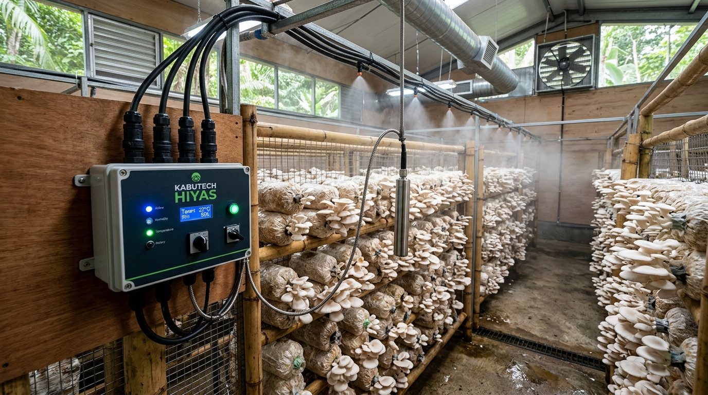
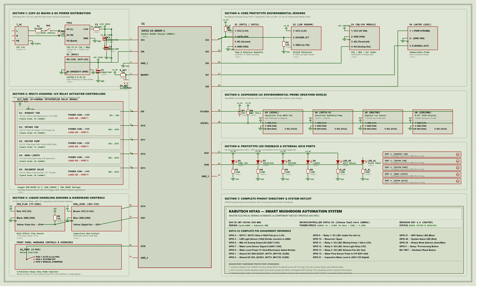

# Kabutech Hiyas — Smart Mushroom Cultivation Mobile & IoT System


An end-to-end **IoT + cross-platform mobile monitoring and automation system** designed for Oyster Mushroom (*Pleurotus ostreatus*) cultivation chambers. Built with **Agentic AI development workflows**, **React Native (Expo)**, **TypeScript**, **Firebase Realtime Database**, and **ESP32-S3** firmware—backed by **manual mobile testing**, **41 Jest unit tests across 7 suites**, and **5 resolved defect reports tracked via GitHub Issues**.

<p align="center">
  
  
</p>

---

## Project Overview

Kabutech Hiyas connects a physical cultivation chamber controller to a real-time mobile app for farm owners and staff:

| Subsystem | Tech Stack | Highlights |
| :--- | :--- | :--- |
| **Mobile App (`KabutechNative/`)** | React Native, Expo, TypeScript, Firebase | **24 screens** across **2 user roles** (Admin & Staff), real-time telemetry, offline fallback, harvest & batch tracking, push alerts, and remote device scheduling. |
| **Embedded Firmware (`firmware/`)** | C++ / Arduino, ESP32-S3, TFT Display | Digital sensor monitoring (temperature, humidity, light, CO₂), local TFT dashboard, automated fan/mister/light relay control, and Firebase cloud sync. |
| **Edge AI / TinyML (`tinyml/`)** | Python, TensorFlow Lite Micro | On-device climate drift forecasting model (`forecaster_int8.tflite`) and anomaly simulation datasets. |
| **Documentation & Hardware (`docs/`)** | Schematics, BOM, Architecture Guides | Complete system overview, pinout diagrams, sensor probe enclosure designs, and Firebase schema. |

---

## QA, Testing & Defect Tracking

Quality assurance combined **manual end-to-end mobile/hardware testing** with **automated Jest unit testing**:

- **Automated Unit Tests (`KabutechNative/__tests__/`):** **41 unit tests across 7 test suites** covering:
  - `alertsLogic.test.ts` — Environmental alert threshold evaluation
  - `controlBands.test.ts` — Automated climate control bands & hysteresis rules
  - `environmentRanges.test.ts` — Sensor range status classification
  - `scheduleLogic.test.ts` — Automated device scheduling logic
  - `AwwSnapOfflineView.test.tsx` — Offline fallback UI rendering
  - `WaterLevelCard.test.tsx` — Water level status component rendering
  - `App.test.tsx` — Application root & ErrorBoundary smoke test
- **Manual Testing Scope:** Tested live Firebase telemetry updates, offline recovery states, push notifications, role-based access (Admin vs. Staff), modal interactions, mobile responsive layouts, and ESP32-S3 TFT hardware behavior.
- **Agentic AI Workflow:** Built and iteratively refined using structured project rules (`.agents/rules/`), followed by hands-on manual verification to catch and fix edge-case defects.

### Resolved Defects Tracked via GitHub Issues (5 Closed)

| Issue | Defect Summary | Fix Commit | Status |
| :--- | :--- | :---: | :---: |
| [#1](https://github.com/Zandro2005/kabutech-hiyas/issues/1) | Pop-up modals glitch on fast taps & Controls screen timers stay active in background | `17756b2` | Closed |
| [#2](https://github.com/Zandro2005/kabutech-hiyas/issues/2) | New user registration redirects to the wrong authentication path | `17756b2` | Closed |
| [#3](https://github.com/Zandro2005/kabutech-hiyas/issues/3) | Hardware screen uptime timer resets incorrectly on dashboard refresh | `353536c` | Closed |
| [#4](https://github.com/Zandro2005/kabutech-hiyas/issues/4) | Saving media fails on Live Farm screen (`MediaLibrary` export issue) | `b59c76d` | Closed |
| [#5](https://github.com/Zandro2005/kabutech-hiyas/issues/5) | Crop analytics 2-column layout breaks on mobile & stale cached data persists | `7f46524`, `b202775` | Closed |

---

## Repository Structure

```text
kabutech-hiyas/
├── KabutechNative/                 # React Native (Expo) TypeScript mobile app
│   ├── __tests__/                  # 7 Jest unit test suites (41 tests)
│   └── src/
│       ├── components/             # Reusable telemetry cards, gauges & modals
│       ├── config/                 # Crop profiles & control band definitions
│       ├── context/                # Auth, Firebase data, theme & crop contexts
│       ├── hooks/                  # Real-time sensor health, history & alerts hooks
│       ├── navigation/             # Role-based Admin & Staff tab navigators
│       ├── screens/                # 24 mobile screens (Admin & Staff views)
│       ├── services/               # Firebase client configuration
│       └── utils/                  # Schedule logic, notifications, range evaluators
├── firmware/                       # ESP32-S3 sensor hub & TFT display firmware
├── tinyml/                         # Edge AI training scripts & TFLite models
├── docs/                           # Architecture, hardware schematics & BOM
└── .agents/rules/                  # Agentic AI engineering & QA guidelines
```

---

## Quick Start & Running Tests

### Prerequisites
- **Node.js** `v20+` and **npm**
- **Expo Go** (Android/iOS) or Android Emulator for mobile testing

### Install & Run Mobile App
```bash
cd KabutechNative
npm install
npm start
```

### Run Automated Jest Unit Tests
```bash
cd KabutechNative
npm test
```

---

## Additional Documentation
- [System Overview](docs/01%20-%20System%20Architecture/system_overview.md)
- [Current Project State](docs/01%20-%20System%20Architecture/current_project_state.md)
- [Firebase Realtime Database Schema](docs/01%20-%20System%20Architecture/firebase_schema.md)
- [Hardware Schematics & Pinouts](docs/02%20-%20Hardware%20%26%20Electronics/schematics_and_pinouts.md)

