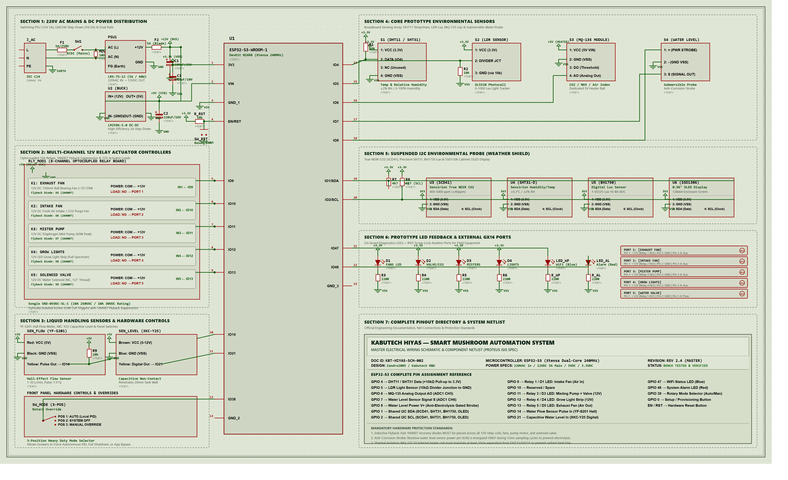

# Kabutech Hiyas — Master Hardware Wiring & Schematic Specification

> **System Architecture**: ESP32-S3 Automated Mushroom & Crop Cultivation Environment  
> **Schematic Standard**: Proteus ISIS Electronic Design Automation (EDA) Specification  
> **Master Wiring & Pinouts PDF (Complete Multi-Subsystem)**: [`firmware/assets/kabutech_hiyas_master_wiring_specification.pdf`](assets/kabutech_hiyas_master_wiring_specification.pdf)  
> **Interactive Master Wiring Guide (HTML)**: [`firmware/assets/kabutech_hiyas_master_wiring_guide.html`](assets/kabutech_hiyas_master_wiring_guide.html)  
> **Vector CAD Source**: [`firmware/assets/kabutech_hiyas_schematic.svg`](assets/kabutech_hiyas_schematic.svg)  
> **Interactive CAD Viewer**: [`firmware/assets/kabutech_hiyas_schematic_viewer.html`](assets/kabutech_hiyas_schematic_viewer.html)  
> **High-Resolution Master Render**: [`firmware/assets/kabutech_hiyas_schematic.png`](assets/kabutech_hiyas_schematic.png)  
> **Pure Schematic PDF (Clean Blueprint)**: [`firmware/assets/kabutech_hiyas_pure_schematic.pdf`](assets/kabutech_hiyas_pure_schematic.pdf)  
> **Zero-Text Schematic PDF (Symbols Only)**: [`firmware/assets/kabutech_hiyas_schematic_no_text.pdf`](assets/kabutech_hiyas_schematic_no_text.pdf)  
> **Full Proteus Edition PDF**: [`firmware/assets/kabutech_hiyas_schematic_proteus.pdf`](assets/kabutech_hiyas_schematic_proteus.pdf)

---

## 1. Master Schematic Diagram

The complete electronic circuit schematic for the **Kabutech Hiyas** automated cultivation control system is rendered below in authentic Proteus ISIS CAD format (sage `#DFE5D5` canvas, 10px dot coordinate grid, `#005500` orthogonal signal traces with solder junction nodes, `#990000` discrete components with `<TEXT>` attribute placeholders, and isolated functional subcircuits).

*To explore the vector schematic with pan, zoom (up to 500%), and interactive coordinate inspection, open the [Interactive Schematic Viewer](assets/kabutech_hiyas_schematic_viewer.html) directly in any web browser.*

---

## 2. Complete ESP32-S3 Pinout Allocation Matrix

The table below defines every active GPIO pin, its net name, subsystem assignment, physical interface, signal type, operating voltage, and dedicated protection/conditioning circuitry:

| ESP32-S3 Pin | Net Name | Connected Hardware Subsystem | Signal Type | Logic Level | Protection / Conditioning Hardware |
| :--- | :--- | :--- | :--- | :--- | :--- |
| **3V3** | `+3.3V` | Internal 3.3V Power Rail | Power Out | 3.3V DC | AMS1117-3.3 Regulated / 10µF Tantalum Filter |
| **VIN** | `+5V` | Primary System 5V Logic Rail | Power In | 5.0V DC | LM2596 Buck Output / 220µF 25V Electrolytic Filter |
| **GND** | `GND` | Common Digital & Signal Ground | Ground | 0V | Unified System Ground Plane |
| **GPIO 9** | `RELAY_FAN_EXH` | Relay K1 — 120mm Exhaust Fan | Digital Output | 3.3V (Active LOW) | Optocoupler PC817 Isolation + 1N4007 Flyback Diode (D5) |
| **GPIO 10** | `RELAY_FAN_INT` | Relay K2 — Intake / Circulation Fan | Digital Output | 3.3V (Active LOW) | Optocoupler PC817 Isolation + 1N4007 Flyback Diode (D6) |
| **GPIO 11** | `RELAY_PUMP` | Relay K3 — 60W High-Pressure Misting Pump | Digital Output | 3.3V (Active LOW) | Optocoupler PC817 Isolation + 1N4007 Flyback Diode (D7) |
| **GPIO 12** | `RELAY_LIGHT` | Relay K4 — 12V Full-Spectrum LED Grow Strip | Digital Output | 3.3V (Active LOW) | Optocoupler PC817 Isolation + 1N4007 Flyback Diode (D8) |
| **GPIO 13** | `RELAY_VALVE` | Relay K5 — 12V NC Solenoid Water Valve | Digital Output | 3.3V (Active LOW) | Optocoupler PC817 Isolation + 1N4007 Flyback Diode (D9) |
| **GPIO 14** | `FLOW_PULSE` | YF-S201 Hall-Effect Water Flow Sensor | Interrupt / Digital In | 3.3V Pulses | 10kΩ Pull-Up (R8) + 5V→3.3V Resistor Divider |
| **GPIO 21** | `LEVEL_CAP` | XKC-Y25 Non-Contact Capacitive Level Sensor | Digital Input | 3.3V High/Low | 5V Open-Collector Pull-Up / 3.3V Logic Clamping |
| **GPIO 38** | `MODE_AUTO_MAN` | 3-Position Control Rotary Switch | Digital Input | 3.3V Logic | 10kΩ Pull-Down Resistor (R9) |
| **GPIO 4** | `DHT11_DATA` | Prototype Benchtop DHT11 Temp/Humidity | Single-Wire Bus | 3.3V Logic | 4.7kΩ Pull-Up Resistor (R1) |
| **GPIO 5** | `LDR_ANALOG` | Prototype GL5528 Photoresistor | Analog Input (ADC1) | 0–3.3V Analog | 10kΩ Resistor (R2) in Voltage Divider Config |
| **GPIO 6** | `MQ135_ANALOG` | Prototype MQ-135 Gas / Air Quality Sensor | Analog Input (ADC1) | 0–3.3V Analog | 5V Heater Rail + 22kΩ Load Resistor (RL) |
| **GPIO 7** | `WATER_SENSE` | Submersible Resistive Water Level Probe | Analog Input (ADC1) | 0–3.3V Analog | 10kΩ Pull-Down (R3) to System Ground |
| **GPIO 8** | `WATER_PWR_GATE` | Water Level Sensor Strobe Power Gate | Digital Output | 3.3V Strobe | Anti-Electrolysis Duty Cycle Strobing (Active 50ms) |
| **GPIO 1** | `I2C_SDA` | I2C Umbilical Bus — Data Line | Serial Data (I2C) | 3.3V Open-Drain | 4.7kΩ Bus Pull-Up (R4) to +3.3V Rail |
| **GPIO 2** | `I2C_SCL` | I2C Umbilical Bus — Clock Line | Serial Clock (I2C) | 3.3V Open-Drain | 4.7kΩ Bus Pull-Up (R5) to +3.3V Rail |
| **GPIO 47** | `LED_WIFI` | Front Panel / On-Board WiFi Status LED (D1) | Digital Output | 3.3V Active High | 330Ω Current-Limiting Resistor (R6) |
| **GPIO 10** | `TFT_CS` | 3.2" SPI TFT Display — Chip Select (CS) | Digital Output | 3.3V Logic | Active LOW select |
| **GPIO 15** | `TFT_DC` | 3.2" SPI TFT Display — Data / Command (DC/RS) | Digital Output | 3.3V Logic | Low=Command, High=Data |
| **GPIO 6** | `TFT_RST` | 3.2" SPI TFT Display — Hardware Reset (RESET) | Digital Output | 3.3V Logic | Active LOW hardware reset |
| **GPIO 17** | `TFT_MOSI` | 3.2" SPI TFT Display — SPI Data In (SDI / MOSI) | Serial Data (SPI) | 3.3V Logic | Master Out Slave In |
| **GPIO 18** | `TFT_SCK` | 3.2" SPI TFT Display — SPI Clock (SCK / CLK) | Serial Clock (SPI) | 3.3V Logic | High-speed 40MHz SPI clock |
| **GPIO 2** | `TFT_LED` | 3.2" SPI TFT Display — Backlight (LED) | PWM Output | 3.3V PWM | LovyanGFX PWM dimming (or tie to 3.3V) |
| **GPIO 16** | `TFT_MISO` | 3.2" SPI TFT Display — SPI Data Out (SDO / MISO) | Serial Data (SPI) | 3.3V Input | Optional read-back line |
| **5VIN** | `TFT_VCC` | 3.2" SPI TFT Display — Power (VCC) | Power Rail | 5V DC | 5VIN from USB (J1 jumper on TFT left OPEN) |

---

## 3. Detailed Subsystem Circuit Analysis

### Subcircuit 1: Dual-Rail Power Distribution Network
- **AC Mains Entrance**: 220VAC Line (`L`) and Neutral (`N`) enter through an industrial IEC C14 panel inlet fitted with a 5A glass cartridge fuse (`F1`) and a DPST illuminated rocker switch (`SW1`).
- **Surge Suppression**: A 275V Metal Oxide Varistor (`MOV1`) is connected across `L` and `N` to clamp line transients, inductive spikes, and grid surges.
- **12V DC Master Supply**: An enclosed 12V 5A (60W) switching power supply (`PSU1`) converts 220VAC to a stabilized +12V rail. The positive output passes through an automotive mini-blade fuse (`F2`, 5A).
- **5V Logic Rail**: An LM2596 high-efficiency DC-DC step-down buck converter (`U2`) steps down the 12V rail to +5.0V (up to 3A) to power the optocoupler relay coils, MQ-135 internal heater element, and logic sensors. Decoupled with `C1` (100µF 25V) on the input and `C2` (220µF 16V) on the output.
- **3.3V MCU Rail**: The ESP32-S3 on-board AMS1117-3.3 linear regulator derives ultra-low noise +3.3V for the Xtensa dual-core MCU, ADC conditioning networks, and sensitive digital I2C bus sensors. Filtered with `C3` (10µF 16V Tantalum) and `C4` (100nF Ceramic).

### Subcircuit 2: Actuator Drivers & Relay Opto-Isolation
- **Module Architecture**: Standard 8-Channel 5V active-low relay module with integrated PC817 optocouplers, status LEDs, and flyback suppression diodes.
- **Galvanic Isolation (Crucial Jumper Setting)**:
  - Remove the default jumper connecting `VCC` and `JD-VCC`.
  - Connect `JD-VCC` directly to the LM2596 **+5V rail** to power the relay electromagnet coils.
  - Connect `VCC` on the input header to the ESP32 **+3.3V rail** to power the optocoupler input LEDs.
  - Connect Relay `IN1` through `IN5` to ESP32 **GPIO 9, 10, 11, 12, 13**.
  - **Do NOT** connect the ESP32 ground to the relay coil ground if complete galvanic isolation is required.
- **Inductive Load Snubbers**:
  - Across every 12V DC inductive actuator (Exhaust Fan, Circulation Fan, 60W Misting Pump, Solenoid Valve), a 1N4007 diode (`D5`–`D9`) is soldered in **reverse parallel** (Cathode / Band to +12V, Anode to Relay Contact).
  - This absorbs high-voltage reverse EMF back-EMF spikes (up to 150V) generated when the inductive coil collapses, protecting the relay contacts from pitting and preventing MCU brownouts/crashes.

### Subcircuit 3: Breadboard Environmental Sensors
- **DHT11 (Temp/Hum)**: Pin 1 to +3.3V, Pin 4 to GND, Pin 2 Data to GPIO 4. A 4.7kΩ pull-up resistor (`R1`) stabilizes the bidirectional single-wire timing protocol.
- **GL5528 LDR (Ambient Light)**: Forms a voltage divider with a 10kΩ metal film resistor (`R2`). One leg to +3.3V, junction to GPIO 5 (ADC1_CH4), other leg through `R2` to GND. Dark resistance >1MΩ, 10 Lux resistance ~10kΩ.
- **MQ-135 (Air Quality / CO₂ Surrogate)**: Pin 1/3 (Heater + Logic VCC) to +5.0V (the heating coil requires 5V for valid tin-dioxide catalyst activation). Pin 2 to GND. Analog output (A0) passes through an adjustable load resistor network to GPIO 6 (ADC1_CH5).
- **Submersible Water Level Probe (Anti-Electrolysis Strobe)**:
  - In standard continuous-power circuits, submerged copper traces undergo rapid galvanic electrolysis and dissolve within weeks.
  - In this circuit, the probe's positive electrode is driven by **GPIO 8** (`WATER_PWR_GATE`).
  - The firmware energizes GPIO 8 only for **50 milliseconds** immediately before taking an ADC reading on **GPIO 7**, then pulls GPIO 8 LOW for the remainder of the 5-minute sampling interval.
  - A 10kΩ pull-down resistor (`R3`) holds GPIO 7 stable at 0V when unpowered.

### Subcircuit 4: Suspended I2C Agro Weather Shield Probe
- **Umbilical Bus Architecture**: An external 4-conductor shielded aviation cable (GX16) carries `+3.3V`, `GND`, `SDA` (GPIO 4), and `SCL` (GPIO 5) from the main enclosure to the sensor probe hanging inside the mushroom fruiting chamber.
- **10-Meter Aviation Cable Engineering Requirements**:
  - **I2C Clock Speed**: Lowered to **25 kHz** in firmware. Over 10 meters, cable capacitance reaches ~1200–1500 pF; standard 100 kHz fails because RC rise times exceed the pulse width. 25 kHz provides 20µs half-periods for crystal-clear logic HIGH transitions.
  - **Pull-Up Resistors (`R4`, `R5`)**: Use **2.2kΩ** (or 1.8kΩ) pull-ups to +3.3V at the ESP32 transmitter end to rapidly charge the 10-meter cable capacitance.
  - **Sensor Probe Decoupling Capacitor**: Add a **100µF 10V electrolytic capacitor + 100nF ceramic capacitor** across +3.3V and GND directly at the sensor probe breakout inside the chamber. This buffers the ~75mA current pulses drawn by the Sensirion SCD41 optical emitter and prevents brownouts on the SHT31.
  - **Cable Shielding**: Solder the braided shield to **System GND only at the main enclosure end** (leave floating at the sensor probe end) to block inductive EMI from fan motors and misting pumps without creating ground loops.
- **Connected I2C Devices**:
  1. **Sensirion SCD41 (True NDIR CO₂)**: Address `0x62`. Photoacoustic optical measurement (400–5000 ppm range, ±40 ppm accuracy).
  2. **Sensirion SHT31-D (Industrial Temp/RH)**: Address `0x44`. High-accuracy digital relative humidity (±2% RH, ±0.2°C).
  3. **ROHM BH1750 (Digital Lux)**: Address `0x23`. 16-bit ambient illuminance sensor (1–65535 lx).
  4. **SSD1306 (0.96" OLED Display)**: Address `0x3C`. Local cabinet diagnostic screen rendering real-time telemetry.

### Subcircuit 5: Liquid Handling & Enclosure Controls
- **YF-S201 Flow Sensor**: Turbine rotor with Hall-effect magnetic pickup. Powered by +5V. Pulse output line pulled up via 10kΩ resistor (`R8`) and divided to 3.3V logic before connecting to GPIO 14 (hardware interrupt). Frequency: $f = 7.5 \times Q$ (L/min).
- **XKC-Y25 Capacitive Level Sensor**: Non-contact sensor mounted to the exterior wall of the water reservoir. Detects water presence through plastic container walls up to 12mm thick. Connects to GPIO 21.
- **3-Position Mode Switch (`SW2`)**: Auto / Off / Manual rotary switch. GPIO 38 reads HIGH in Auto mode, LOW in Off/Manual mode via 10kΩ pull-down `R9`.
- **Reset Button (`SW3`)**: Momentary normally-open tactile pushbutton pulling ESP32 `EN` pin to ground for clean system reboots.

---

## 4. External Aviation Connector (GX16) Pinout Specification

For ruggedized modular cabinet wiring, all chamber connections use industrial GX16 4-pin screw-lock aviation connectors:

| Connector Port | Destination Device | Pin 1 | Pin 2 | Pin 3 | Pin 4 | Cable Type |
| :--- | :--- | :--- | :--- | :--- | :--- | :--- |
| **Port J1** | Weather Shield Probe (I2C) | `+3.3V` (VCC) | `GND` | `SDA` (GPIO 1) | `SCL` (GPIO 2) | 4-Core 22AWG Shielded Twisted Pair |
| **Port J2** | 120mm Exhaust Fan | `+12V` (Switched) | `GND` | N/C | N/C | 2-Core 18AWG High-Flex |
| **Port J3** | 120mm Intake Fan | `+12V` (Switched) | `GND` | N/C | N/C | 2-Core 18AWG High-Flex |
| **Port J4** | 60W Misting Pump | `+12V` (Switched) | `GND` | N/C | N/C | 2-Core 16AWG Heavy-Duty |
| **Port J5** | LED Grow Strip | `+12V` (Switched) | `GND` | N/C | N/C | 2-Core 18AWG Silicon |
| **Port J6** | Reservoir Sensors (Flow + Level) | `+5V` (VCC) | `GND` | `FLOW` (GPIO 14) | `LEVEL` (GPIO 21) | 4-Core 22AWG Shielded |

---

## 5. Complete Bill of Materials (BOM) Cross-Reference

| Ref Des | Component Description | Value / Specification | Proteus CAD Label | Footprint / Package |
| :--- | :--- | :--- | :--- | :--- |
| **U1** | ESP32-S3 Microcontroller | DevKit N16R8 (16MB Flash, 8MB PSRAM) | `ESP32-S3` `<TEXT>` | DIP-44 / Dual-Header Module |
| **U2** | Step-Down Buck Converter | LM2596S DC-DC Regulator (12V → 5V 3A) | `LM2596` `<TEXT>` | Module / TO-263-5 |
| **U3** | True NDIR CO₂ Sensor | Sensirion SCD41 (I2C Address `0x62`) | `SCD41` `<TEXT>` | 4-Pin JST-SH Breakout |
| **U4** | Precision Temp/Humidity Sensor | Sensirion SHT31-D (I2C Address `0x44`) | `SHT31-D` `<TEXT>` | 4-Pin I2C Breakout |
| **U5** | Digital Ambient Light Sensor | ROHM BH1750 (I2C Address `0x23`) | `BH1750` `<TEXT>` | 5-Pin I2C Breakout |
| **U6** | Cabinet Diagnostic Display | 0.96" I2C Monochrome OLED (`0x3C`) | `SSD1306` `<TEXT>` | 4-Pin Header Module |
| **U7** | Benchtop Temp/Humidity Sensor | DHT11 Single-Wire Protocol | `DHT11` `<TEXT>` | 4-Pin Single-In-Line |
| **U8** | Gas / Air Quality Sensor | MQ-135 with 5V Catalytic Heater | `MQ-135` `<TEXT>` | 4-Pin Header Module |
| **K1–K5** | 8-Channel Relay Module | Songle SRD-05VDC-SL-C (10A 250VAC) | `RELAY_1`–`RELAY_5` | Optocoupled 8-Relay Board |
| **D1, D2** | Panel Diagnostic LEDs | 3mm High-Brightness LED (Blue/Red) | `LED` `<TEXT>` | Radial Through-Hole |
| **D5–D9** | Flyback Freewheeling Diodes | 1N4007 General Purpose Rectifier (1000V 1A)| `1N4007` `<TEXT>` | DO-41 Axial Through-Hole |
| **MOV1** | Metal Oxide Varistor Surge Suppressor | 275VAC 10kA Clamping | `275V_MOV` `<TEXT>` | 14mm Radial Disc |
| **F1** | AC Line Cartridge Fuse | 5A 250V Slow-Blow Glass Fuse | `5A_FUSE` `<TEXT>` | 5x20mm Fuse Holder |
| **F2** | DC Secondary Fuse | 5A 32V Mini Blade Automotive Fuse | `5A_BLADE` `<TEXT>` | In-Line Blade Holder |
| **R1, R4, R5**| Pull-Up Resistors | 4.7kΩ 0.25W Metal Film 1% | `4k7` `<TEXT>` | AXIAL-0.4 |
| **R2, R3, R8, R9**| Voltage Divider / Pull-Downs | 10kΩ 0.25W Metal Film 1% | `10k` `<TEXT>` | AXIAL-0.4 |
| **R6, R7** | LED Current-Limiting Resistors | 330Ω 0.25W Carbon Film 5% | `330R` `<TEXT>` | AXIAL-0.4 |
| **C1** | Buck Input Filter Capacitor | 100µF 25V Low-ESR Radial Electrolytic | `100uF_25V` `<TEXT>` | RAD-0.2 |
| **C2** | Buck Output Filter Capacitor | 220µF 16V Low-ESR Radial Electrolytic | `220uF_16V` `<TEXT>` | RAD-0.2 |
| **C3** | 3.3V Rail Tantalum Filter | 10µF 16V SMD Tantalum | `10uF_16V` `<TEXT>` | SMD 1206 / Case B |
| **C4** | High-Frequency Bypass Capacitor | 100nF (0.1µF) 50V Multilayer Ceramic | `100nF` `<TEXT>` | RAD-0.1 / Ceramic Disc |
| **J1–J6** | Industrial Enclosure Connectors | GX16 4-Pin Aviation Threaded Sockets | `CONN_GX16` `<TEXT>` | Panel-Mount 16mm |
| **SW1** | AC Master Power Switch | KCD1 Illuminated DPST Rocker (250V 6A) | `KCD1_DPST` `<TEXT>` | Panel Cutout Snap-In |
| **SW2** | Automation Mode Selector | 3-Position Rotary Switch (Auto/Off/Man) | `ROTARY_3POS` `<TEXT>` | 16mm Bushing Panel-Mount |
| **SW3** | MCU Hardware Reset Switch | Momentary Tactile Pushbutton (NO) | `TACT_SW` `<TEXT>` | 6x6mm Through-Hole |
| **PSU1** | Primary Power Supply Unit | 12V 5A (60W) Enclosed Switching PSU | `PSU_12V_5A` `<TEXT>` | Enclosed Aluminum Chassis |

---

## 6. Assembly & Safety Guidelines

1. **High Voltage Isolation**:
   - The 220VAC line carries lethal voltages. Ensure all mains connections inside the enclosure are insulated with heat-shrink tubing and shrouded inside an IP65 junction box.
   - Maintain at least 6.3mm of physical clearance between 220VAC wiring and 12V/5V DC wiring.
2. **Flyback Diode Orientation**:
   - Diodes `D5` through `D9` are polarized. The silver cathode ring **MUST** connect to the positive (+12V) terminal, and the black anode end **MUST** connect to the relay switched ground/negative terminal. Reversing diode polarity will cause an immediate dead short across the 12V supply.
3. **Anti-Electrolysis Duty Cycle Strobing**:
   - Never tie the submersible water level probe directly to continuous 3.3V or 5V. Ensure firmware strobes GPIO 8 only during active analog acquisition (50ms pulse).
4. **Star Grounding**:
   - Avoid daisy-chaining ground wires between high-current inductive actuators (misting pump, fans) and sensitive analog sensors. Implement a central star ground bus terminal at the LM2596 ground pad.
